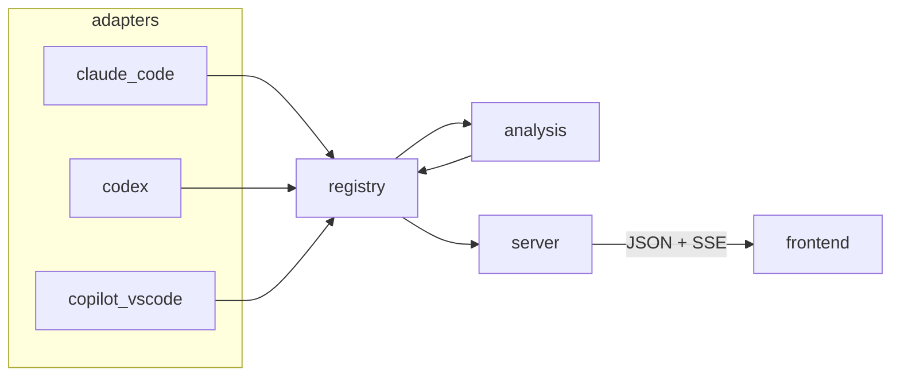

# Architecture

agentprof is a local web app that shows AI coding agent sessions as call trees with timings, tokens, cost and waste findings.
A Python backend parses session files into an agent-neutral model, analyses it, and serves it over a JSON API to a React frontend.

This page is the map.
The browser UI's behaviour is described in [the session view page](session-view.md).

## Repository layout

```
src/agentprof/
  cli.py                  # `agentprof` command: build registry, resolve argument, run server, open browser
  model.py                # agent-neutral data model (Session, Node, Metric, ...)
  registry.py             # one row per session, background summaries, analysis cache, change events
  pricing.py, pricing.json  # model price table -> estimated USD
  adapters/
    base.py               # AgentAdapter protocol, SessionRef, SessionSummary, AdapterConfig
    __init__.py           # load_adapters(): instantiate entry points of group `agentprof.adapters`
    common.py             # iter_jsonl and malformed-line details, first_line, title_from_prompts
    turns.py, timestamps.py, execution.py  # more helpers shared by adapters
    claude_code/          # ~/.claude/projects/<project>/<sid>.jsonl + subagents/
    codex/                # ~/.codex/sessions: grouped rollout JSONL files + subagents
    copilot_vscode/       # VS Code workspaceStorage: session + transcript + debug log
  analysis/
    pipeline.py           # analyze(): the analysis steps in order
    identity.py           # logical agent owners and stable call keys
    execution.py          # resolve event-to-call links within one logical agent
    rollup.py             # derived metrics, bottom-up
    call_context.py       # same-agent call gaps and intervening events
    heuristics.py         # waste heuristics W1–W5, W7, W8
    evidence_findings.py  # evidence findings E1–E7
    finding_references.py # stable node, call and event references cited by findings
    agent_summary.py      # one row per logical agent for `/summary` and `SessionOut.agents`
    activity.py           # running/waiting state per node
    finding_order.py      # findings order and `Finding.rank`
    session_index.py      # node, parent and entry lookups and a memo per analysed session
    transcripts.py        # transcript scoping, ordering, paging and search
  server/
    app.py                # FastAPI app, SSE broadcaster, static file serving
    schemas.py            # response models; mirror models validate from the neutral model
    transcript_schema.py  # transcript response models
    pricing_schema.py     # price-table response model
    openapi.py            # dumps the OpenAPI schema for frontend type generation
    static/               # built frontend (generated, git-ignored)
frontend/src/
  api/                    # fetch client, query hooks, SSE handling, generated schema.ts
  pages/                  # SessionListPage (/), SessionPage (/sessions/:id)
  components/             # React components; see "Frontend" below
  lib/                    # pure logic with unit tests; see "Frontend" below
  test/                   # test data factories and workflow fixtures
frontend/e2e/             # Playwright specs
tests/                    # pytest, mirrors src/; adapter fixtures under tests/adapters/*/fixtures
tools/qa/                 # dev-only package: `qa`, `build-dist`, `smoke`
docs/                     # architecture, session view, coding conventions, releasing
```

## Layering



Keep these boundaries:

- `model.py` depends on nothing; everything else depends on it.
- Adapters know nothing about each other, the registry or the server.
- The analysis layer sees only the neutral model, never native tool ids or file formats.
- The server only translates the neutral model into response schemas.
- The frontend sees only the API; its types are generated from the OpenAPI schema.

## Components

### Neutral model (`model.py`)

**Tree**

- A `Session` has a `root` node of kind `session`.
- Its children are `turn` nodes, one per user prompt.
- Turns and agents contain `agent` nodes (nested sub-agents) and `tool` nodes (leaf tool calls).
- Turns and agents own their `LlmCall`s and `ExecutionEvent`s.
- The session node stands for the main agent's whole life; its calls stay on the turns.

**Metrics**

- Every number is a `Metric` or `CostMetric` with a `Provenance`: `exact`, `estimated` or `n/a`.
- Token counts `input`, `output`, `cache_read` and `cache_write` are disjoint.
- `cache_write_5m` and `cache_write_1h` split `cache_write` when the source records the split; otherwise both are `n/a`.
- `context_size` of a call is `input + cache_read + cache_write`.
- Side requests (`LlmCall.in_context == False`) count for tokens and cost, never for the context.
- `context_peak` and `compactions` describe a node's own context; on the session node they cover all turns.
- `sum_metrics` and `extreme_metric` combine metrics and downgrade provenance when values are missing.

**Costs**

- Costs keep their native unit (`USD`, or `credits` for Copilot) and are never added across units.
- `CostMetric.usd` converts with `usd_per_unit`; Copilot's rate is `usd_per_credit` in `pricing.json`.
- Codex costs are API-equivalent estimates from the price table.

**Tools**

- `ToolInfo.category` is the neutral class heuristics use; `native_id` keeps the agent's own name.
- `ToolInfo.paths` lists every file a call touches; `writes_file` marks whole-file writes.
- `ToolInfo.blocks_on_user` marks a call that waits for the user's answer; adapters set it, analysis never matches tool ids.
- A resume links to an agent node only when its target matches exactly one harness agent id.

**Execution events**

- An event records its kind, optional id and subject, time, source order and result status.
- Event-to-call links have a relation (`requested_by`, `consumed_by`, `next_observed_call`) and an evidence kind (`recorded`, `observed_order`).
- Timestamps and adjacency never create causality.

**Transcripts**

- `TranscriptEntry`s live on their owning node, together with a `TranscriptCoverage`.
- An entry holds ordered `TranscriptBlock`s: messages, reasoning, tool requests and results, delegations, compactions.
- Entry ids combine the physical source stream with source and block positions.
- `text=None` means no readable text; `text=""` is a recorded empty body.
- Encrypted blocks never carry ciphertext.

### Adapters (`adapters/`)

An adapter implements the `AgentAdapter` protocol in `adapters/base.py`:

| Method | Cost | Purpose |
|---|---|---|
| `discover()` | cheap | list `SessionRef`s (id, path, newest mtime of all the session's files) |
| `open_path(path)` | cheap | recognise a file given on the command line, else `None` |
| `summarize(ref)` | parse without transcript bodies | `SessionSummary` for the list row (title, workspace, times, total cost) |
| `analyze(ref)` | full | complete `Session` tree with raw metrics |

Rules for all adapters:

- Each package splits into `discovery.py`, parser modules, `tools.py`, `tree.py` and `adapter.py`.
- Adapters are built with an `AdapterConfig` (root overrides, pricing file) and registered as entry points in `pyproject.toml`.
- Adapters set only what they know; the roll-up derives the rest.
- Missing or ambiguous source data stays `n/a` or unresolved, never a guessed zero.
- Parse problems go into `Session.diagnostics` instead of raising, unless the session is unreadable.
- Read JSONL files with `common.iter_jsonl`; it records undecodable lines, and a parser records lines it cannot process with `MalformedLines.add`, so every adapter reports malformed-line details.
- Keep each per-record ownership decision in a pure function with a table-driven test (`copilot_vscode/ownership.decide_owner`, `codex/rollout.decide_record_owner`, `claude_code/tree._tool_event_owner`); a new `ownership_evidence` value gets its own test row.
- `summarize` skips transcript retention (`retain_native=False` in the Claude Code and Codex parsers); only `analyze` builds transcript entries.
- `summarize` and `analyze` must report the same total cost; `tests/test_adapter_contract.py` checks this.

Agent specifics:

- **Claude Code:** `compact_boundary` entries become exact compactions; `<synthetic>` messages are outside the context.
- **Codex:** rollout files are grouped by root session id; each token-usage record becomes an LLM call; sub-agent rollouts nest under their delegation calls.
- **Copilot:** sub-agent tool arguments come from the transcript; the most frequent debug-log `debugName` is the conversation, other kinds are side requests; debug-log span ids are call identities.

### Analysis (`analysis/`)

`pipeline.analyze(adapter, ref)` is the only entry point.
Its steps mutate the tree in place, and their order matters:

1. `adapter.analyze` builds the tree.
2. `identity.assign_call_keys` stores each call's stable key on `LlmCall.call_key`.
3. `execution.resolve_execution_links` resolves event links to a unique call in the same logical agent.
4. `rollup.roll_up` fills tokens, cost, time spans, tool counts and context peaks bottom-up, keeping the worst provenance.
5. `call_context.annotate_call_context` sets `gap`, `preceding_events` and `cold_rewrite` on each call.
6. `heuristics.find_findings` and `evidence_findings.find_evidence_findings` produce findings.
7. Findings are attached to the nodes they name.
8. `finding_order.rank_findings` stores each finding's position in the session order on `Finding.rank`.

Compactions:

- Adapters may record compactions.
- Otherwise the roll-up estimates one wherever the context drops below half of the previous call's (`_COMPACTION_DROP`).
- The main agent is checked across all turns; a sub-agent over its own calls.

Findings:

- **Waste heuristics** (`W1`–`W5`, `W7`, `W8`) are small per-node checks in `heuristics._CHECKS`, run on every turn and agent.
- **Evidence findings** (`E1`–`E7`) work per logical agent: cache rewrites, waits, context growth, idle parents, resumes, long gaps, compactions.
- Findings cite nodes, calls and events through `finding_references`; `call_references(owner)` builds all of an owner's call references in one pass, matched by call identity.
- `identity.call_keys` is the only definition of a call's key: a unique native id, else a unique exact timestamp, else none.
- `identity.owned_nodes` is the only definition of a node's logical agent owner.
- `finding_order.ordered_findings` is the only definition of the findings order: known avoidable USD, severity, then event time.
- `activity.node_activity` is the only definition of a node's running or waiting state; the frontier is the root's end.
- Observed cost and estimated avoidable cost are kept separate.
- Finding costs must not be summed: several findings may cite the same call.

### Registry (`registry.py`)

- Holds one `SessionRow` per session; it is the only stateful component.
- A row's state (`pending`, `summarized`, `error`) is relative to the session's current mtime, so a changed file makes it stale.
- A daemon thread re-runs `discover` every 3 s and summarises one pending row per `step()`, newest first.
- The worker never analyses.
- `analysed(id)` analyses on demand, deduplicates concurrent requests and caches `AnalysedSession`s (session, mtime, `SessionIndex`) keyed by mtime; `session(id)` returns the session and mtime only.
- The cache keeps at most 20 analyses and, beyond the most recent one, at most 256 MiB of their source files.
- With `reanalysis_interval_s` (10 s in the app, 0 by default), a session that changed within that interval of its last analysis gets the previous analysis; `release_held()`, called by the worker, announces it again once it may be re-analysed.
- A failed analysis is remembered for the file version it failed on.
- Every row change emits a `RegistryEvent` (`updated` or `removed`).
- All public methods are thread-safe behind one `RLock`.

### Server (`server/`)

`create_app(registry, pricing=...)` builds the FastAPI app:

| Endpoint | Returns |
|---|---|
| `GET /api` | endpoint index |
| `GET /api/sessions` | all rows as `SummaryOut`, newest first |
| `GET /api/sessions/events` | SSE: `updated` (a `SummaryOut`) and `removed` (`{id}`) |
| `GET /api/pricing` | effective price table |
| `GET /api/sessions/{id}` | `SessionOut`: full tree with metrics, findings and the agent rows, no long texts; optional `depth` and `fields` |
| `GET /api/sessions/{id}/summary` | one row per logical agent with cost and cache breakdowns |
| `GET /api/sessions/{id}/findings` | flat findings in `analysis/finding_order.py` order |
| `GET /api/sessions/{id}/diagnostics` | parse counts and redacted malformed-line details |
| `GET /api/sessions/{id}/nodes/{node_id}` | prompt, result and raw tool arguments |
| `GET /api/sessions/{id}/transcript` | a window of entry metadata (default 50, max 100) with cursors |
| `GET /api/sessions/{id}/transcript/entries/{entry_id}` | one entry's full blocks and references |
| `GET /api/sessions/{id}/transcript/search` | literal case-insensitive search with snippets |
| `GET /sessions/{id}` with JSON `Accept` or `format=json` | the same `SessionOut` |
| `GET /` and `/sessions/{id}` | built frontend shell |

Behaviour:

- Unknown ids return 404; a session that fails to analyse returns 422.
- Transcript bodies appear only in the entry endpoint, never in tree, list or SSE responses.
- Transcript cursors are bound to session, scope, query and filter; a vanished cursor entry returns 409.
- Without `node_id`, transcript listing and search cover the whole session; with it, the node's ownership scope.
- Routes look up nodes and transcript entries through the cached `SessionIndex`; `scope_entries` memoises each scope's ordered entries on it.
- The `Broadcaster` moves registry events from the worker thread onto the asyncio loop, one queue per SSE client.
- `schemas.py` builds the `depth`/`fields` projection; `app.py` maps its `ValueError` to 422.
- `SessionOut.agents` embeds the same rows as `/summary`.
- `/summary` `own_cost` can be summed across rows; `subtree_cost` cannot.
- Requests whose `Host` header is not a loopback name or the bound host return 400 (protection against DNS rebinding); a wildcard bind (`0.0.0.0`, `::`) disables the check.

### Frontend (`frontend/`)

- Stack: Vite, React, TypeScript, Mantine, react-router, TanStack Query, Table and Virtual.
- `pnpm --dir frontend build` writes the bundle into `src/agentprof/server/static/`, which ships in the wheel.
- `pnpm --dir frontend dev` proxies `/api` to a running `agentprof` on port 8765.
- Put new logic in `lib/` as pure, tested functions; keep components to layout and wiring.

```
main.tsx          MantineProvider -> QueryClientProvider -> BrowserRouter -> App
App.tsx           useSessionEvents() once; routes "/" and "/sessions/:sessionId"
pages/
  SessionListPage   session table with filters
  SessionPage       loads one session, renders SessionView
components/
  session workspace
    SessionView         inspection, selection, scope, follow mode, history and split-pane state
    SessionInteraction  shared interaction context and inspection memory
    SessionHeader       title, badges, headline figures, diagnostics
    WorkflowToolbar     scope, activity filter and follow-latest controls
    WorkflowBreadcrumbs focused scope hierarchy
    WorkflowStatus      workflow state capsule
    AgentSummaryTable   one row per logical agent, from `session.agents`
    AgentBadge          agent id capsule
    FindingsDrawer      all findings of the session, in server rank order
  tree and timeline
    TreeTimeline        virtualised tree table with timeline column
    ContextCell         peak context cell
    ActivityTrack       one node's activity on a time view
    ActivityHitGroup    overlapping marks and candidate inspection
    AxisLabels          time labels
  node drawer
    NodeDrawer          tabbed details; composes the components below
    NodeOverview        task, outcome, previews and metrics
    NodeFindings        one node's findings
    FindingEvidence     finding links, costs and raw evidence
    CacheSection        cache quantities and costs
    NodeTimeline        mini Gantt of a node and its sub-agents
    CostSection         cost per LLM call chart
    ContextSection      context per LLM call chart
    ChartValueAxis      shared chart axes
    ChildNodesTable     sub-agents, or a session's turns
    LlmCallsTable       chronological calls and tool invocations
    LlmCallRow, ToolExecutionRow, ToolGroupRow, ActivityInspectionRow   its row kinds
    ToolExecutionDetails expanded tool details
    SequenceControls    sort and compact/all settings
    ArtifactsTable      files written or edited
    TranscriptSection   paged, searchable transcript
    MarkdownMessage     safe Markdown rendering
    RecordedContentLink link from a call or event to its transcript entry
  shared
    DetailLink          caption links that open inspection
    InspectionMenu      shared context menu
lib/                pure functions, no React
  tree, entities, findingGroups, findingReferences   rows, entity references, findings
  inspectionLocation, inspectionActions, workflowLocation   URL state and detail links
  workflowState, workflowScope, workflowReading     observed state, scope, reading anchor
  executionSequence, toolExecutions, inspectionSequence, llmCallRows, eventRelations   call sequence
  timeline, drawerTimeDomain, chartScale, context, cost, cache   chart geometry and figures
  agentColor, metricColor, artifacts, transcript, localMarks, entityHitGroups
  filters, paging, splitPane, format, severity
api/                client, query hooks, SSE, types
```

#### Data layer (`api/`)

- `schema.ts` is generated by `pnpm --dir frontend gen:api`; never edit it by hand.
- `types.ts` re-exports its schemas under short names; all other code imports from there.
- `client.ts` holds the fetch functions and `queryKeys`; `hooks.ts` wraps them as query hooks.
- Queries never go stale by themselves (`staleTime: Infinity`); only server events refresh data.
- The UI uses only the list, session, node and transcript endpoints.
- The frontend never computes call keys; it reads `call_key` from the API, and tests key synthetic sessions with `src/test/callKeys.ts`.
- It reads agent rows from `session.agents` and finding order from `rank` (`rankedFindings` in `lib/tree.ts`); tests build both for synthetic sessions with `served()` from `src/test/served.ts`.

| Query key | Data |
|---|---|
| `["sessions"]` | session list |
| `["session", id]` | analysed session tree |
| `["node", id, nodeId]` | node detail; `["node", id]` invalidates all nodes of a session |
| `["transcript", id, ...]` | transcript pages, searches and entries |

`events.ts` opens one `EventSource` for the whole app:

- `updated` replaces the list row and invalidates that session's transcript queries.
- If the event's mtime is newer than the cached session, the session and its nodes are refetched.
- `removed` drops the row and invalidates its transcript queries.
- A (re)connect invalidates the list and all transcript queries.

#### Frontend tests

- Vitest covers `lib/` (except `severity.ts`), `api/client.ts`, `api/events.ts` and components with a `*.test.ts`.
- `src/test/factories.ts` builds typed test data; `src/test/workflowFixtures.ts` holds larger trees.
- Playwright (`frontend/e2e/`) runs the real `agentprof` on the Claude Code fixtures.
- Several specs replace API responses with synthetic sessions through `page.route`.
- Stable test ids are listed on [the session view page](session-view.md#stable-test-ids).

### CLI (`cli.py`)

- Usage: `agentprof [SESSION|PATH] [--host] [--port] [--no-browser] [--copilot-root] [--claude-root] [--codex-root] [--pricing]`.
- Loads the price table once and shares it with all adapters and the server.
- Loads adapters, runs one `registry.refresh()` and resolves the optional argument (exit code 2 if unknown or ambiguous).
- Starts the worker thread and uvicorn.
- Opens the browser once the server accepts connections.

## Data flow

### Startup and background

```
cli.main
  -> load_adapters(config)                    entry points -> adapter instances
  -> Registry.refresh()                       adapter.discover() -> pending rows
  -> Registry.start()                         worker thread:
       every 3 s: refresh()                   new / changed / vanished sessions
       step():    adapter.summarize(ref)      -> row.summary       -> event "updated"
  -> uvicorn(create_app(registry))
```

### Session list

```
browser GET /api/sessions -> registry.rows() -> summary_out(row) -> SummaryOut[]
registry event -> Broadcaster -> SSE "updated"/"removed" -> api/events.ts -> query cache -> table re-renders
```

### Session view

```
browser GET /api/sessions/{id}
  -> registry.analysed(id)                    cache hit by mtime, or:
       pipeline.analyze(adapter, ref)         adapter.analyze -> call keys -> resolve links -> roll_up -> call context -> findings
       cache (LRU, 20 sessions / 256 MiB source)
  -> session_out(session, mtime) -> SessionOut
node selected -> GET .../nodes/{node_id} -> prompt, result, arguments
Content tab -> GET .../transcript, .../transcript/search, .../transcript/entries/{entry_id}
file changes -> worker emits "updated" with newer mtime -> frontend refetches the open session
```

## Extending

### Add an agent adapter

1. Create `adapters/<name>/` with the usual split (`discovery`, parsers, `tools`, `tree`, `adapter`).
   Use `adapters/common.py` for JSONL reading and titles.
2. Implement the four protocol methods; `name` becomes the id prefix `<name>:<native-id>`.
3. Include every file the session depends on in `SessionRef.mtime` (use `latest_mtime`).
4. Map every native tool id in `tools.py`; unknown ids map to `other` and are counted in diagnostics.
5. Register it under `[project.entry-points."agentprof.adapters"]` and add a root option in `cli.adapter_config`.
6. Add anonymised fixtures under `tests/adapters/<name>/fixtures` and add the adapter to `tests/test_adapter_contract.py`.
7. Add a display label in `frontend/src/lib/format.ts`.

### Add a heuristic

1. Add a `_check_*(node) -> list[Finding]` function to `analysis/heuristics.py` and append it to `_CHECKS`.
2. Use only tool categories, normalised arguments and metrics.
3. Add one positive and one negative test in `tests/analysis/test_heuristics.py`.

### Add an evidence finding

1. Add a `_check_*` function to `analysis/evidence_findings.py` when the finding needs a logical agent's calls in order or the `call_context` annotations, and register it in `_CHECKS`.
2. Read what the shared `_Context` holds (each logical agent's timed calls, compactions and the node index), and read `gap`, `gap_basis`, `preceding_events` and `cold_rewrite` from the calls instead of recomputing them.
3. Use the next free `E` id and cite calls with `_Context.call_ref` and nodes and events with `finding_references`.
4. Keep observed and avoidable costs separate.
5. Add tests in `tests/analysis/test_evidence_findings.py`; a test that relies on the annotations runs `annotate_call_context` first or sets them on the calls.

### Change the API

1. Change the response model in `server/schemas.py` (transcripts: `server/transcript_schema.py`).
   A model that mirrors a neutral-model dataclass inherits `_FromModel` and needs no mapping code: give it the same field names and Pydantic reads them from the object.
   Write explicit mapping code only where the API differs, as in `node_out`, `summary_out` and the transcript responses.
   Shared `Literal`s live in `model.py`.
2. Run `pnpm --dir frontend gen:api` and commit `frontend/src/api/schema.ts`; CI checks that it is current.
3. Update `frontend/src/test/factories.ts` if test data changes shape.

### Change the session view

- **Tree column:** update the tree grid CSS, add the header cell and add the cell to `NodeCells`.
- **Scope or activity filter:** add matching to `lib/workflowScope.ts`, URL patching to `lib/workflowLocation.ts`, and wire it through `SessionView` and `WorkflowToolbar`.
- **Session-view switch:** keep its state in `SessionView` and expose it in a toolbar or the header.
- **Timeline mark:** add its geometry to `lib/timeline.ts` with a test and draw it in `ActivityTrack`.
- **New value:** change the API first.

### Add an agent-table column

Add the value to `AgentGroup` in `analysis/agent_summary.py` and to `AgentSummaryRowOut` in `server/schemas.py`, regenerate the schema, and show it in `AgentSummaryTable`.
Update `src/test/agentRows.ts` so synthetic sessions get it too.

### Add a derived metric

Compute it in `analysis/rollup.py` for all agents rather than in an adapter.

## Tooling

- `uv run qa` runs ruff, ty and pytest, plus Biome, `tsc` and Vitest when the frontend is set up.
- `pnpm --dir frontend e2e` builds the frontend and runs the Playwright specs.
- `uv run build-dist` builds frontend, wheel and sdist and smoke-tests the wheel; see [releasing.md](releasing.md).
